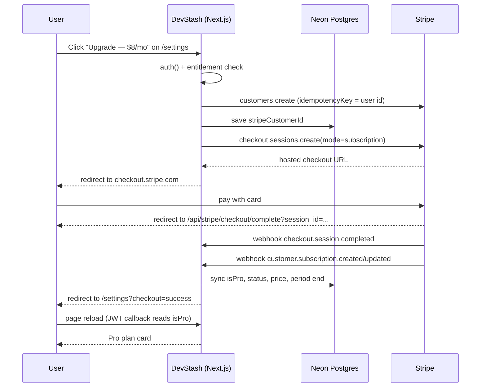

# Stripe Subscription Integration Plan

**Last Updated**: 2026-10-22
**Scope**: DevStash Pro subscriptions — $8/month or $72/year — using Stripe Checkout, the Stripe Customer Portal and webhooks.
**Status**: Proposal. No billing code or Stripe dependency exists in the repository yet.

**Sources**

- `context/project-overview.md` — plan limits, Pro features, tech stack.
- `context/coding-standards.md` — server actions, API routes, validation, error handling, testing.
- `prisma/schema.prisma` — current `User`, `Item`, `Collection` models.
- `src/auth.ts`, `src/auth.config.ts`, `src/types/next-auth.d.ts` — Auth.js v5 configuration.
- `src/actions/{items,collections,profile,settings}.ts` — server-action conventions.
- `src/app/api/**/route.ts` — route-handler conventions.
- `src/app/(dashboard)/settings/page.tsx`, `src/components/settings/editor-preferences-card.tsx` — settings layout.
- `src/components/dashboard/{sidebar,item-create-dialog,collection-create-dialog}.tsx` — current Pro markers and create flows.
- `src/app/api/upload/route.ts`, `src/lib/upload.ts` — file/image upload path.
- `docs/item-types.md` §Observations — existing Free/Pro discrepancy.
- `docs/item-crud-architecture.md` §12 — open questions on gating.
- Next.js 16 route-handler guide: `node_modules/next/dist/docs/01-app/01-getting-started/15-route-handlers.md`.
- Stripe Node SDK v23 (API version `2026-09-30.endive`), Checkout, Billing Portal and webhook signing docs.

---

## 1. Executive Summary

The integration uses the three standard Stripe building blocks:

| Concern | Approach |
| --- | --- |
| Starting a subscription | Server-created **Stripe Checkout Session** (`mode: "subscription"`), then redirect the browser to its hosted URL. No Stripe.js or publishable key required. |
| Managing/cancelling | **Stripe Customer Portal** session created by a server action. Stripe owns payment-method updates, invoices and cancellation. |
| Keeping the database in sync | A single **webhook route** at `POST /api/stripe/webhook`, verified with `stripe.webhooks.constructEvent`, handling `checkout.session.completed`, `customer.subscription.created`, `customer.subscription.updated` and `customer.subscription.deleted`. |
| Entitlement flag | Keep the existing denormalized `User.isPro` boolean, written only by webhook/reconciliation code. Subscription status, price, period end and cancel-at-period-end are stored alongside it for display. |
| Session freshness | The JWT callback re-reads `isPro` from the database on every session read, as requested in the research prompt, so a page reload after checkout shows Pro without a sign-out. |
| Enforcement | Server-side checks in `createItem`, `createCollection` and `POST /api/upload`. UI checks are advisory only. |

### Key decisions

1. **Hosted Checkout, not embedded Elements.** The app has no Stripe client SDK, no payment UI, and the project standards say to use API routes for third-party integrations and webhooks. Hosted Checkout is the smallest correct surface and keeps card data out of the app.
2. **Webhooks are the source of truth.** A return redirect is only a UX hint. Every entitlement change comes from a signed Stripe event. The success route adds a reconciliation pass to cover the redirect-vs-webhook race.
3. **`isPro` remains a stored boolean.** It is the fast path for UI and actions. `stripeSubscriptionStatus` is stored for display/debugging, but never read as the sole entitlement source in hot paths.
4. **Subscription state is written by one helper.** `syncStripeSubscription` and `clearStripeSubscription` are the only places that write billing fields, so webhook and reconciliation cannot drift.
5. **Gating is centralized.** Limits and Pro-only types live in `src/lib/billing.ts` and are checked in server actions/routes, not in components.

---

## 2. Current State Analysis

### 2.1 User model

`prisma/schema.prisma` already has the three fields the project spec called for:

```prisma
model User {
  id                   String   @id @default(cuid())
  name                 String?
  email                String   @unique
  emailVerified        DateTime?
  image                String?
  password             String?
  isPro                Boolean  @default(false)
  stripeCustomerId     String?
  stripeSubscriptionId String?
  editorPreferences    Json?
  // relations...
}
```

| Field | Current state | Gap |
| --- | --- | --- |
| `isPro` | Exists, defaults `false` | Never written anywhere; no webhook or billing code. |
| `stripeCustomerId` | Exists, nullable, not unique | No code creates or reads it. Add `@unique` so webhook customer lookups are unambiguous. |
| `stripeSubscriptionId` | Exists, nullable, not unique | No code creates or reads it. Add `@unique` and use it to ignore stale events. |
| Subscription status | Missing | Needed to distinguish `active` / `trialing` / `past_due` / `canceled`. |
| Price / interval | Missing | Needed to show whether the user is on monthly or yearly. |
| Current period end | Missing | Needed for "Renews on …" / "Pro until …" copy. |
| Cancel at period end | Missing | Needed for "Cancels on …" copy after portal cancellation. |

No migration is needed for the three existing columns; one migration adds the four display/robustness columns and the two unique constraints.

### 2.2 Auth and session handling

- `src/auth.ts` uses the Auth.js v5 split-config pattern: `src/auth.config.ts` is edge-safe (GitHub + a placeholder Credentials provider) and `src/auth.ts` adds the Prisma adapter, the real bcrypt Credentials provider and a JWT session strategy.
- The only callback today is `session`, which copies `token.sub` to `session.user.id`.
- `src/types/next-auth.d.ts` augments `Session.user` with `id`.
- There is **no `SessionProvider`** and no `useSession()` call anywhere in `src/`. Client components get user data as props from server components. This matters for the UI plan: we do not need to add `SessionProvider`; a small billing context seeded by the `(dashboard)` layout is a better fit.
- `src/proxy.ts` protects `/dashboard`, `/collections`, `/favorites`, `/items`, `/profile` and `/settings`. It does **not** match `/api/**`, so `/api/stripe/webhook` is reachable without a session by default. The webhook authenticates via its signature, not via `auth()`.

Auth.js internals confirm the JWT callback runs on every session read (`node_modules/@auth/core/lib/actions/session.js` calls `callbacks.jwt` before `callbacks.session`). The research prompt's workaround is therefore valid: a database read inside `jwt` runs whenever `auth()` is called.

### 2.3 How user data is accessed

| Layer | Pattern | Example |
| --- | --- | --- |
| Server components | Call `auth()` for the session, then call a `src/lib/db/*` helper directly. | `(dashboard)/dashboard/page.tsx`, `(dashboard)/settings/page.tsx` |
| Server actions | `"use server"`, `auth()` first, Zod parse, `try/catch`, return `{ success, data?, error? }`. | `src/actions/items.ts`, `src/actions/collections.ts` |
| Route handlers | `getSessionUserId()` + `jsonError()` / `unauthorized()` helpers. | `src/app/api/collections/route.ts`, `src/app/api/upload/route.ts` |
| DB helpers | `src/lib/db/*`, plain serialisable return shapes, `connection()` for request-time rendering. | `src/lib/db/items.ts`, `src/lib/db/collections.ts` |
| Client components | Receive server data as props; mutate via server actions; `router.refresh()` after success. | `ItemCreateDialog`, `CollectionCreateDialog` |

Important caveat found during research: several dashboard helpers still scope to the hardcoded `DEMO_USER_EMAIL` (`getPinnedItems`, `getRecentItems`, `getItemStats`, `getItemsByType`, `getItemTypes`, `getItemTypeById`). Newly registered users therefore see demo data on the dashboard. Billing checks must not depend on those helpers; they must query the signed-in `session.user.id` directly. This is a pre-existing issue, not caused by Stripe, but it will make the Pro experience look inconsistent until it is fixed.

### 2.4 Existing subscription/payment code

There is none:

- No `stripe` dependency in `package.json`.
- No `src/app/api/stripe/**` routes.
- No `src/actions/billing.ts`.
- No code reads or writes `isPro`, `stripeCustomerId` or `stripeSubscriptionId`.
- `src/lib/mock-data.ts` contains `isPro: true` for a mock user, but the module is unused.
- The only Pro signal in the UI is `PRO_TYPE_IDS = new Set(["file", "image"])` in `src/components/dashboard/sidebar.tsx`, which renders an outline `PRO` badge.

### 2.5 Settings page structure

`src/app/(dashboard)/settings/page.tsx` is a protected server component in the `(dashboard)` group. It:

1. Calls `auth()` and redirects to `/sign-in` if there is no session.
2. Calls `getAccountSettings(userId)` for `{ hasPassword }`.
3. Renders a header, `<EditorPreferencesCard />` and `<AccountActions hasPassword={...} />`.

The page is the natural home for billing: add a `<BillingCard />` section above editor preferences, with an `id="billing"` anchor. No new route or navigation entry is required, although a "Billing" item in the user menu is a reasonable optional follow-up.

### 2.6 Patterns the billing code will follow

**API routes**

- Named method exports in `src/app/api/**/route.ts` (`export async function POST`).
- `getSessionUserId()` for user-scoped routes, with `unauthorized()` and `jsonError()` from `src/lib/api.ts`.
- `NextResponse.json({ success: true, data })` for success; `jsonError(message, status)` for failures.
- `export const runtime = "nodejs"` when the route needs Node-only libraries (the Stripe SDK, Tigris, bcrypt).
- Route handlers are not cached for non-GET methods, so the webhook does not need cache configuration.

**Server actions**

- `"use server"` at the top of the module.
- `auth()` first; the user id always comes from the session, never from the client payload.
- Zod `safeParse` before any mutation, returning the first issue message.
- `try/catch` around I/O, `console.error` the internal error and return a generic user-facing message.
- `{ success, data?, error? }` result objects; no thrown errors for expected failures.
- Client components call actions, show `toast.error`/`toast.success`, and call `router.refresh()` after a successful mutation.

**Environment variables**

- Document every variable in `.env.example`; real values live in `.env` and the deployment environment.
- Read `process.env` at call time (inside the client factory or action), not at module scope, so builds and tests work without billing configuration.
- Create expensive clients lazily and cache them per process.
- Never expose the Stripe secret or price IDs to the browser.

**Webhooks**

- Raw body via `await request.text()`.
- `stripe-signature` header + `constructEvent`.
- 400 for a bad/missing signature, 500 for a transient handler failure (Stripe retries), 200 for success or an ignored event.
- Acknowledge unknown event types with 200 so Stripe stops retrying them.

---

## 3. Feature Gating Analysis

### 3.1 Plan matrix

| Capability | Free | Pro |
| --- | --- | --- |
| Items | 50 | Unlimited |
| Collections | 3 | Unlimited |
| Snippet, prompt, command, note, link | Yes | Yes |
| File items | No | Yes |
| Image items | No (see discrepancy below) | Yes |
| Custom item types | No | Yes |
| AI tagging, summaries, explain, prompt optimization | No | Yes |
| JSON / ZIP export | No | Yes |

### 3.2 What is enforced today

Nothing.

- `createItem` has no item count or type check.
- `createCollection` has no collection count check.
- `POST /api/upload` accepts uploads from any signed-in user.
- The sidebar Pro badge is decorative.
- The Free limits exist only in `context/project-overview.md` and the homepage copy.

### 3.3 Where to enforce

| Surface | File | Check |
| --- | --- | --- |
| Create item | `src/actions/items.ts` → `createItem` | Reject `file`/`image` when not Pro; reject when a Free user already has 50 items. |
| Create collection | `src/actions/collections.ts` → `createCollection` | Reject when a Free user already has 3 collections. |
| Upload file/image | `src/app/api/upload/route.ts` | Reject any upload from a non-Pro user before writing to Tigris. This prevents storage abuse even if the UI is bypassed. |
| Create custom type (future) | Future action | Reject when not Pro. The schema already supports `ItemType.userId`. |
| AI actions (future) | Future actions/routes | Reject when not Pro. |
| Export (future) | Future route | Reject when not Pro. |

Action-level enforcement is essential. The UI checks below only improve the experience; they are never the security boundary.

### 3.4 UI gating

| Component | Change |
| --- | --- |
| `ItemCreateDialog` | Lock the `file`/`image` type buttons for Free users with a `Lock` icon and a "Pro" hint. Show an upgrade banner when at the 50-item limit. Include the type and limit checks in `canSubmit` so a stale selection cannot be submitted. |
| `CollectionCreateDialog` | Show an upgrade banner and disable Create when a Free user has 3 collections. |
| `SidebarContent` | Replace the local `PRO_TYPE_IDS` set with the shared `PRO_ONLY_TYPE_IDS` from `src/lib/billing.ts`. Optionally hide the badge for Pro users. |
| `UserMenu` | Optional: show a `Free` / `Pro` badge and an "Upgrade" item linking to `/settings#billing`. |
| `BillingCard` | Show plan, usage, renewal/cancellation date and upgrade/manage buttons on `/settings`. |
| Error toasts | Server action errors already surface through `toast.error`. Include "Upgrade to Pro" in the message, or add a sonner action linking to `/settings#billing`. |

The billing context (`BillingProvider` + `useBilling`) is seeded once by the `(dashboard)` server layout and re-rendered by `router.refresh()` after creates, so counts stay reasonably fresh. Server actions remain authoritative.

The marketing homepage's pricing CTAs currently point at `/register`. That is correct for logged-out visitors; signed-in users upgrade from `/settings`. If product wants a direct homepage upgrade link for signed-in users, the pricing section would need to become session-aware, which is a separate change.

### 3.5 Inconsistencies to resolve before implementing

These are real conflicts in the current project documents and marketing copy:

1. **Image uploads: Free or Pro?**
   - `context/project-overview.md` Free tier: "Basic search, image uploads, no AI".
   - Pro tier: "File uploads, custom types, AI features, export".
   - `src/components/dashboard/sidebar.tsx`: both `file` and `image` show a `PRO` badge.
   - `docs/item-types.md` §Observations calls this out explicitly.
   - The research prompt says "Pro-only features (file uploads, AI, custom types, export)" but does not mention images.
   - **Recommendation:** treat both `file` and `image` as Pro (`PRO_ONLY_TYPE_IDS = ["file", "image"]`) to match the existing sidebar and the upload system. Update `context/project-overview.md` and the homepage Free-plan bullets. If product wants images on Free, set `PRO_ONLY_TYPE_IDS = ["file"]` and remove the image badge; the rest of this plan is unchanged.
2. **Trial or no trial?**
   - Homepage Pro card: "Start 14-day trial".
   - Project spec pricing table: no trial.
   - This plan assumes **no trial**. Either change the homepage CTA to "Upgrade to Pro" or add `trial_period_days: 14` to `subscription_data` and treat `trialing` as Pro. Do not ship a "14-day trial" CTA without a trial in checkout.
3. **Pricing display**
   - Stripe prices must be exactly $8.00 USD recurring monthly and $72.00 USD recurring yearly. The homepage displays the yearly plan as "$6 / month" with "Billed $72 once a year", which is consistent with the annual price but not a separate $6 monthly price.
4. **Past-due policy**
   - This plan keeps Pro access during `past_due` (Stripe is retrying the payment) and revokes on `unpaid` / `canceled`. If the product prefers immediate revocation, remove `past_due` from `PRO_SUBSCRIPTION_STATUSES`.

---

## 4. Architecture

### 4.1 High-level flow



### 4.2 Checkout flow

1. `createCheckoutSession(interval)` server action:
   - `auth()` and validate `interval`.
   - Read entitlements from the DB. Reject if already Pro.
   - Read or create the Stripe customer. Use `stripe.customers.create(..., { idempotencyKey: \`devstash-customer-${userId}\` })` so concurrent clicks and retries return the same customer.
   - Persist `stripeCustomerId`.
   - Create a Checkout Session with `mode: "subscription"`, `client_reference_id: userId`, `metadata.userId`, `subscription_data.metadata.userId`, the correct price ID and success/cancel URLs.
   - Return `{ success: true, data: { url } }`; the client calls `window.location.assign(url)`.
2. Stripe Checkout collects payment and creates the subscription.
3. Stripe sends webhooks. The database is updated by `syncStripeSubscription`.
4. Stripe redirects to the success route. That route retrieves the Checkout Session, verifies it belongs to the signed-in user, and calls the same sync helper. This closes the race where the browser redirect arrives before the webhook.
5. The settings page re-renders. The JWT callback reads `isPro` from the DB, so the session is fresh.

### 4.3 Webhook flow

1. Read the raw body with `await request.text()`. Do not call `request.json()` first; the signature is over the exact bytes.
2. Read the `stripe-signature` header.
3. Verify with `stripe.webhooks.constructEvent(payload, signature, secret)`. Node runtime, no `bodyParser` configuration.
4. Dispatch:
   - `checkout.session.completed` → resolve the subscription, sync by `client_reference_id`.
   - `customer.subscription.created` / `customer.subscription.updated` → sync by customer (`stripeCustomerId`), falling back to `subscription.metadata.userId`.
   - `customer.subscription.deleted` → clear only when the deleted subscription is still the user's current one.
   - Everything else → ignore and return 200.
5. Return 200 quickly. Return 500 only for transient failures so Stripe retries. Return 400 for an invalid signature (Stripe will not retry those).

### 4.4 Status → Pro policy

```ts
export const PRO_SUBSCRIPTION_STATUSES = ["active", "trialing", "past_due"] as const;
```

| Stripe status | `isPro` | Notes |
| --- | --- | --- |
| `active` | `true` | Normal paid subscription. |
| `trialing` | `true` | Only relevant if a trial is added later. |
| `past_due` | `true` | Grace period while Stripe retries the card; show a payment warning. |
| `unpaid`, `canceled`, `incomplete`, `incomplete_expired`, `paused` | `false` | Access is revoked. Existing data is retained. |

If the product wants stricter behavior, change the array in one place (`src/lib/billing.ts`).

### 4.5 Session sync workaround

The research prompt asks for the JWT callback to always read `isPro` from the database. The documented `trigger === "update"` path is not a good fit: it requires a client call to `useSession().update()`, the app has no `SessionProvider`, and a Stripe webhook has no way to trigger that client call. Reading the database in the JWT callback covers server reads, client session fetches and the reload after checkout without any client-side coordination.

Auth.js calls `callbacks.jwt` on every session read (`node_modules/@auth/core/lib/actions/session.js`), so this works. It costs one small primary-key query per `auth()` call. A `(dashboard)` page typically calls `auth()` in the layout and again in the page, plus once per server action; that is two to three extra queries per request.

Add a `try/catch` so a transient database failure does not break sign-in or silently revoke Pro. Keep the previous token value on failure.

If this ever becomes a bottleneck, add a `token.isProCheckedAt` timestamp and refresh at most once every 30–60 seconds. The trade-off is that webhook changes take up to that long to surface. The requested behavior is "always sync", so the plan uses that as the default.

### 4.6 Why not Stripe Elements / embedded checkout?

- No `@stripe/stripe-js` or `@stripe/react-stripe-js` is installed.
- Hosted Checkout avoids handling card data, SCA/3DS, wallets and localization.
- The Customer Portal avoids building a billing-management UI.
- The only Stripe code that runs in the app is server-side: SDK calls and webhook verification.

---

## 5. Data Model Changes

### 5.1 Schema

```prisma
model User {
  id            String    @id @default(cuid())
  name          String?
  email         String    @unique
  emailVerified DateTime?
  image         String?
  password      String?

  // Billing
  isPro                       Boolean   @default(false)
  stripeCustomerId            String?   @unique
  stripeSubscriptionId        String?   @unique
  stripePriceId               String?
  stripeSubscriptionStatus    String?
  stripeCurrentPeriodEnd      DateTime?
  stripeCancelAtPeriodEnd     Boolean   @default(false)

  // Monaco editor preferences
  editorPreferences Json?

  accounts    Account[]
  sessions    Session[]
  items       Item[]
  itemTypes   ItemType[]
  collections Collection[]
  tags        Tag[]

  createdAt DateTime @default(now())
  updatedAt DateTime @updatedAt
}
```

Field semantics:

| Field | Written by | Purpose |
| --- | --- | --- |
| `isPro` | webhook/reconciliation | Fast entitlement check. Never set by the UI. |
| `stripeCustomerId` | checkout action + webhook | Maps a Stripe customer to a DevStash user. Unique so lookup is unambiguous. |
| `stripeSubscriptionId` | webhook/reconciliation | Current subscription. Used to ignore stale events. Unique because one subscription belongs to one user. |
| `stripePriceId` | webhook/reconciliation | Monthly vs yearly display. |
| `stripeSubscriptionStatus` | webhook/reconciliation | `active`, `trialing`, `past_due`, etc. |
| `stripeCurrentPeriodEnd` | webhook/reconciliation | Renewal / access-until date. |
| `stripeCancelAtPeriodEnd` | webhook/reconciliation | "Cancels on …" copy. |

### 5.2 Migration

Use Prisma migrations, not ad-hoc SQL:

```bash
# On the development branch, after approval (AGENTS.md forbids unapproved DDL):
npx prisma migrate dev --name add_stripe_billing_fields
npm run db:generate
```

This creates a migration under `prisma/migrations/` adding:

- `stripePriceId TEXT`
- `stripeSubscriptionStatus TEXT`
- `stripeCurrentPeriodEnd TIMESTAMP(3)`
- `stripeCancelAtPeriodEnd BOOLEAN NOT NULL DEFAULT false`
- unique indexes on `stripeCustomerId` and `stripeSubscriptionId`

Existing rows have `NULL` in both unique columns; PostgreSQL allows multiple `NULL`s in a unique index, so the migration is safe. Production deploys with `npm run db:deploy` (`prisma migrate deploy`) before the new app version starts.

---

## 6. Files to Create

### 6.1 Environment variables

`.env.example` already contains Stripe placeholders. Keep these names (actual values belong in `.env` locally and in Vercel environment settings):

```bash
# Stripe (https://dashboard.stripe.com) — DevStash Pro subscriptions.
# Secret API key. Server-only; never prefix with NEXT_PUBLIC_.
STRIPE_SECRET_KEY=
# Publishable key. Not required for hosted Checkout; reserve it for Stripe.js.
STRIPE_PUBLISHABLE_KEY=
# Signing secret for the webhook endpoint (Dashboard -> Developers -> Webhooks)
# or the value printed by `stripe listen` during local development.
STRIPE_WEBHOOK_SECRET=
# Recurring price IDs from the DevStash Pro product.
STRIPE_PRICE_ID_MONTHLY=
STRIPE_PRICE_ID_YEARLY=
```

`NEXT_PUBLIC_APP_URL` already exists and is used to build success, cancel and portal return URLs. Set it explicitly in production (for example `https://devstash.app`); the fallback to `VERCEL_URL` points at the deployment host, not a custom domain.

The app must build without Stripe configured. `src/lib/stripe.ts` creates the client lazily and billing actions return a friendly error when configuration is missing.

### 6.2 `src/lib/app-url.ts`

`getAppUrl()` currently lives in `src/lib/email-verification.ts` and is also imported by `src/lib/password-reset.ts`. Move it into a neutral module so billing can use it without importing email code.

```ts
/**
 * Absolute base URL for links and redirects. Priority:
 * NEXT_PUBLIC_APP_URL -> AUTH_URL -> VERCEL_URL -> localhost.
 */
export function getAppUrl(): string {
  const configured =
    process.env.NEXT_PUBLIC_APP_URL ??
    process.env.AUTH_URL ??
    (process.env.VERCEL_URL ? `https://${process.env.VERCEL_URL}` : undefined);

  return (configured ?? "http://localhost:3000").replace(/\/+$/, "");
}
```

Update `src/lib/email-verification.ts` and `src/lib/password-reset.ts` to import from `@/lib/app-url`.

### 6.3 `src/lib/billing.ts`

Pure plan/entitlement rules. No Prisma, no Stripe SDK, no `next/*` imports, so it can be used by server actions, route handlers, client components and Vitest.

```ts
/**
 * Plan entitlements and subscription rules shared by server actions, route
 * handlers and client components. Keep this module free of framework and
 * database imports.
 */

/** Maximum number of items a Free account may own. */
export const FREE_ITEM_LIMIT = 50;

/** Maximum number of collections a Free account may own. */
export const FREE_COLLECTION_LIMIT = 3;

/** System item types reserved for Pro accounts. */
export const PRO_ONLY_TYPE_IDS = ["file", "image"] as const;

export type ProOnlyTypeId = (typeof PRO_ONLY_TYPE_IDS)[number];

export function isProOnlyTypeId(typeId: string): typeId is ProOnlyTypeId {
  return (PRO_ONLY_TYPE_IDS as readonly string[]).includes(typeId);
}

/** Checkout intervals the app sells. */
export const BILLING_INTERVALS = ["monthly", "yearly"] as const;

export type BillingInterval = (typeof BILLING_INTERVALS)[number];

export function isBillingInterval(value: unknown): value is BillingInterval {
  return (
    typeof value === "string" &&
    (BILLING_INTERVALS as readonly string[]).includes(value)
  );
}

/** Display metadata for the pricing UI. Amounts are in cents (USD). */
export const PRO_PLANS = {
  monthly: {
    amount: 800,
    label: "$8",
    period: "/ month",
    note: "Billed monthly. Cancel anytime.",
  },
  yearly: {
    amount: 7200,
    label: "$72",
    period: "/ year",
    note: "Billed $72 once a year — save $24.",
  },
} as const satisfies Record<
  BillingInterval,
  { amount: number; label: string; period: string; note: string }
>;

/**
 * Subscription statuses that grant Pro access. `past_due` is a grace period
 * while Stripe retries a failed payment.
 */
export const PRO_SUBSCRIPTION_STATUSES = [
  "active",
  "trialing",
  "past_due",
] as const;

export function isProSubscriptionStatus(
  status: string | null | undefined,
): boolean {
  return (
    status != null &&
    (PRO_SUBSCRIPTION_STATUSES as readonly string[]).includes(status)
  );
}

export interface BillingEntitlements {
  isPro: boolean;
  itemCount: number;
  collectionCount: number;
}

/** Billing data needed by the settings page. Dates cross the RSC boundary. */
export interface BillingOverview extends BillingEntitlements {
  stripeCustomerId: string | null;
  stripeSubscriptionId: string | null;
  stripePriceId: string | null;
  stripeSubscriptionStatus: string | null;
  stripeCurrentPeriodEnd: Date | null;
  stripeCancelAtPeriodEnd: boolean;
}

export type LimitCheck =
  | { allowed: true }
  | { allowed: false; error: string };

export function checkItemLimit({
  isPro,
  itemCount,
}: Pick<BillingEntitlements, "isPro" | "itemCount">): LimitCheck {
  if (isPro || itemCount < FREE_ITEM_LIMIT) {
    return { allowed: true };
  }

  return {
    allowed: false,
    error: `You've reached the Free plan limit of ${FREE_ITEM_LIMIT} items. Upgrade to Pro for unlimited items.`,
  };
}

export function checkCollectionLimit({
  isPro,
  collectionCount,
}: Pick<BillingEntitlements, "isPro" | "collectionCount">): LimitCheck {
  if (isPro || collectionCount < FREE_COLLECTION_LIMIT) {
    return { allowed: true };
  }

  return {
    allowed: false,
    error: `You've reached the Free plan limit of ${FREE_COLLECTION_LIMIT} collections. Upgrade to Pro for unlimited collections.`,
  };
}

export function checkItemType(typeId: string, isPro: boolean): LimitCheck {
  if (isPro || !isProOnlyTypeId(typeId)) {
    return { allowed: true };
  }

  return {
    allowed: false,
    error: "This item type is a Pro feature. Upgrade to Pro to add it.",
  };
}

/** Combines the type and item-count checks for `createItem`. */
export function checkItemCreation(
  typeId: string,
  entitlement: BillingEntitlements,
): LimitCheck {
  const typeCheck = checkItemType(typeId, entitlement.isPro);

  return typeCheck.allowed ? checkItemLimit(entitlement) : typeCheck;
}

/**
 * True when an event belongs to a subscription the user has already replaced.
 * Older active or deleted events must not overwrite the current subscription.
 * `checkout.session.completed` and the return route pass `replace: true`
 * because they represent a deliberate new purchase.
 */
export function isStaleSubscriptionEvent(
  currentSubscriptionId: string | null,
  incomingSubscriptionId: string,
): boolean {
  return Boolean(
    currentSubscriptionId &&
      currentSubscriptionId !== incomingSubscriptionId,
  );
}
```

### 6.4 `src/lib/validations/billing.ts`

Keeps validation in the established `src/lib/validations/*` location.

```ts
import { z } from "zod";

import { BILLING_INTERVALS } from "@/lib/billing";

export const billingIntervalSchema = z.enum([...BILLING_INTERVALS]);

export type BillingIntervalInput = z.input<typeof billingIntervalSchema>;
```

### 6.5 `src/lib/stripe.ts`

Server-only Stripe client and price configuration. Lazy initialization keeps `next build` working when the environment variables are absent. Treat this module as server-only: never import it from a `"use client"` file (the project does not currently use the `server-only` package).

```ts
import Stripe from "stripe";

import type { BillingInterval } from "@/lib/billing";

/**
 * Server-only Stripe client. Created lazily so builds and non-billing pages do
 * not require Stripe configuration.
 */
let client: Stripe | null = null;

export function isStripeConfigured(): boolean {
  return Boolean(
    process.env.STRIPE_SECRET_KEY &&
      process.env.STRIPE_PRICE_ID_MONTHLY &&
      process.env.STRIPE_PRICE_ID_YEARLY,
  );
}

export function getStripe(): Stripe {
  const secret = process.env.STRIPE_SECRET_KEY;

  if (!secret) {
    throw new Error("STRIPE_SECRET_KEY is not set.");
  }

  client ??= new Stripe(secret, {
    // stripe-node v23 pins API version 2026-09-30.endive. TypeScript will flag
    // this literal after a major SDK upgrade.
    apiVersion: "2026-09-30.endive",
    maxNetworkRetries: 2,
  });

  return client;
}

export function getProPriceId(interval: BillingInterval): string {
  const name =
    interval === "monthly"
      ? "STRIPE_PRICE_ID_MONTHLY"
      : "STRIPE_PRICE_ID_YEARLY";
  const priceId = process.env[name];

  if (!priceId) {
    throw new Error(`${name} is not set.`);
  }

  return priceId;
}

/** Maps a stored price ID back to the billing interval, for display. */
export function intervalForPriceId(
  priceId: string | null,
): BillingInterval | null {
  if (!priceId) return null;
  if (priceId === process.env.STRIPE_PRICE_ID_MONTHLY) return "monthly";
  if (priceId === process.env.STRIPE_PRICE_ID_YEARLY) return "yearly";
  return null;
}
```

Install with `npm install stripe@^23.0.0`. stripe-node v23 uses API version `2026-09-30.endive`, requires Node 20+ (the project runs Node 24 and Next 16 requires 20.9+).

### 6.6 `src/lib/stripe-subscription.ts`

Pure mapping from a Stripe subscription to the fields stored on `User`. Kept separate from the database helper so it is easy to unit test without Stripe or Prisma.

```ts
import type Stripe from "stripe";

import { isProSubscriptionStatus } from "@/lib/billing";

export interface SubscriptionSnapshot {
  subscriptionId: string;
  customerId: string;
  status: string;
  isPro: boolean;
  priceId: string | null;
  currentPeriodEnd: Date | null;
  cancelAtPeriodEnd: boolean;
}

/**
 * Maps a Stripe subscription to the fields stored on `User`.
 *
 * In the current Stripe API, `current_period_end` lives on subscription items,
 * not on the subscription itself. The first item is the Pro price (quantity 1).
 */
export function subscriptionSnapshot(
  subscription: Stripe.Subscription,
): SubscriptionSnapshot {
  const item = subscription.items.data[0];
  const customerId =
    typeof subscription.customer === "string"
      ? subscription.customer
      : subscription.customer.id;

  return {
    subscriptionId: subscription.id,
    customerId,
    status: subscription.status,
    isPro: isProSubscriptionStatus(subscription.status),
    priceId: item?.price.id ?? null,
    currentPeriodEnd: item
      ? new Date(item.current_period_end * 1000)
      : null,
    cancelAtPeriodEnd: subscription.cancel_at_period_end,
  };
}
```

### 6.7 `src/lib/db/billing.ts`

Database reads/writes for billing. Only this module writes billing columns.

```ts
import { connection } from "next/server";
import type Stripe from "stripe";

import {
  isStaleSubscriptionEvent,
  type BillingEntitlements,
  type BillingOverview,
} from "@/lib/billing";
import { prisma } from "@/lib/prisma";
import { subscriptionSnapshot } from "@/lib/stripe-subscription";

/** Billing + usage summary for the settings page. */
export async function getBillingOverview(
  userId: string,
): Promise<BillingOverview | null> {
  await connection();

  const user = await prisma.user.findUnique({
    where: { id: userId },
    select: {
      isPro: true,
      stripeCustomerId: true,
      stripeSubscriptionId: true,
      stripePriceId: true,
      stripeSubscriptionStatus: true,
      stripeCurrentPeriodEnd: true,
      stripeCancelAtPeriodEnd: true,
      _count: { select: { items: true, collections: true } },
    },
  });

  if (!user) return null;

  return {
    isPro: user.isPro,
    itemCount: user._count.items,
    collectionCount: user._count.collections,
    stripeCustomerId: user.stripeCustomerId,
    stripeSubscriptionId: user.stripeSubscriptionId,
    stripePriceId: user.stripePriceId,
    stripeSubscriptionStatus: user.stripeSubscriptionStatus,
    stripeCurrentPeriodEnd: user.stripeCurrentPeriodEnd,
    stripeCancelAtPeriodEnd: user.stripeCancelAtPeriodEnd,
  };
}

/** Lightweight entitlement snapshot for action-level gating. */
export async function getBillingEntitlements(
  userId: string,
): Promise<BillingEntitlements | null> {
  const user = await prisma.user.findUnique({
    where: { id: userId },
    select: {
      isPro: true,
      _count: { select: { items: true, collections: true } },
    },
  });

  if (!user) return null;

  return {
    isPro: user.isPro,
    itemCount: user._count.items,
    collectionCount: user._count.collections,
  };
}

export async function getStripeCustomerId(
  userId: string,
): Promise<string | null> {
  const user = await prisma.user.findUnique({
    where: { id: userId },
    select: { stripeCustomerId: true },
  });

  return user?.stripeCustomerId ?? null;
}

export async function setStripeCustomerId(
  userId: string,
  customerId: string,
): Promise<void> {
  await prisma.user.update({
    where: { id: userId },
    data: { stripeCustomerId: customerId },
  });
}

/** Resolve the DevStash user for a Stripe subscription. */
async function findUserForSubscription(
  subscription: Stripe.Subscription,
  userId?: string,
) {
  const customerId =
    typeof subscription.customer === "string"
      ? subscription.customer
      : subscription.customer.id;

  if (userId) {
    const user = await prisma.user.findUnique({
      where: { id: userId },
      select: { id: true, stripeSubscriptionId: true },
    });

    if (user) return user;
  }

  const metadataUserId = subscription.metadata.userId;

  if (metadataUserId) {
    const user = await prisma.user.findUnique({
      where: { id: metadataUserId },
      select: { id: true, stripeSubscriptionId: true },
    });

    if (user) return user;
  }

  return prisma.user.findFirst({
    where: { stripeCustomerId: customerId },
    select: { id: true, stripeSubscriptionId: true },
  });
}

/**
 * Writes a subscription snapshot to the owning user. Used by the webhook and
 * by the checkout return route. Idempotent: replaying the same event produces
 * the same row state.
 *
 * `replace` is only true for a deliberate new purchase (checkout completed or
 * the return reconciliation). Ordinary subscription events for an older
 * subscription are ignored, so a stale event cannot overwrite the current one.
 */
export async function syncStripeSubscription(
  subscription: Stripe.Subscription,
  options: { userId?: string; replace?: boolean } = {},
): Promise<void> {
  const snapshot = subscriptionSnapshot(subscription);
  const user = await findUserForSubscription(subscription, options.userId);

  if (!user) {
    console.warn(
      `No DevStash user found for Stripe subscription ${subscription.id}`,
    );
    return;
  }

  if (
    !options.replace &&
    isStaleSubscriptionEvent(user.stripeSubscriptionId, subscription.id)
  ) {
    return;
  }

  await prisma.user.update({
    where: { id: user.id },
    data: {
      isPro: snapshot.isPro,
      stripeCustomerId: snapshot.customerId,
      stripeSubscriptionId: snapshot.subscriptionId,
      stripePriceId: snapshot.priceId,
      stripeSubscriptionStatus: snapshot.status,
      stripeCurrentPeriodEnd: snapshot.currentPeriodEnd,
      stripeCancelAtPeriodEnd: snapshot.cancelAtPeriodEnd,
    },
  });
}

/**
 * Clears the entitlement when the current subscription ends. The
 * `stripeSubscriptionId` filter means a late `deleted` event for an old
 * subscription cannot revoke a newer one.
 */
export async function clearStripeSubscription(
  subscription: Stripe.Subscription,
): Promise<void> {
  const snapshot = subscriptionSnapshot(subscription);

  await prisma.user.updateMany({
    where: {
      stripeCustomerId: snapshot.customerId,
      stripeSubscriptionId: snapshot.subscriptionId,
    },
    data: {
      isPro: false,
      stripeSubscriptionId: null,
      stripePriceId: null,
      stripeSubscriptionStatus: subscription.status,
      stripeCurrentPeriodEnd: null,
      stripeCancelAtPeriodEnd: false,
    },
  });
}
```

### 6.8 `src/actions/billing.ts`

Server actions follow the existing `{ success, data, error }` contract. They return a URL instead of calling `redirect()` so they stay unit-testable and the client can show an error toast without a navigation.

```ts
"use server";

import { auth } from "@/auth";
import { getAppUrl } from "@/lib/app-url";
import {
  getBillingEntitlements,
  getStripeCustomerId,
  setStripeCustomerId,
} from "@/lib/db/billing";
import {
  getProPriceId,
  getStripe,
  isStripeConfigured,
} from "@/lib/stripe";
import {
  billingIntervalSchema,
  type BillingIntervalInput,
} from "@/lib/validations/billing";

export interface BillingRedirectResult {
  success: boolean;
  data?: { url: string };
  error?: string;
}

/**
 * Creates a Stripe Checkout Session for the chosen interval and returns its
 * hosted URL. The browser redirects to Stripe; the webhook grants Pro.
 */
export async function createCheckoutSession(
  interval: BillingIntervalInput,
): Promise<BillingRedirectResult> {
  const session = await auth();

  if (!session?.user?.id) {
    return { success: false, error: "You must be signed in to do that." };
  }

  const parsed = billingIntervalSchema.safeParse(interval);

  if (!parsed.success) {
    return { success: false, error: "Invalid billing interval." };
  }

  if (!isStripeConfigured()) {
    return { success: false, error: "Billing is not configured yet." };
  }

  try {
    const entitlement = await getBillingEntitlements(session.user.id);

    if (!entitlement) {
      return { success: false, error: "Account not found." };
    }

    if (entitlement.isPro) {
      return { success: false, error: "You are already on the Pro plan." };
    }

    const stripe = getStripe();
    let customerId = await getStripeCustomerId(session.user.id);

    if (!customerId) {
      // The idempotency key makes concurrent clicks return the same customer.
      const customer = await stripe.customers.create(
        {
          email: session.user.email ?? undefined,
          name: session.user.name ?? undefined,
          metadata: { userId: session.user.id },
        },
        { idempotencyKey: `devstash-customer-${session.user.id}` },
      );

      customerId = customer.id;
      await setStripeCustomerId(session.user.id, customerId);
    }

    const checkout = await stripe.checkout.sessions.create({
      mode: "subscription",
      customer: customerId,
      client_reference_id: session.user.id,
      line_items: [{ price: getProPriceId(parsed.data), quantity: 1 }],
      success_url: `${getAppUrl()}/api/stripe/checkout/complete?session_id={CHECKOUT_SESSION_ID}`,
      cancel_url: `${getAppUrl()}/settings?checkout=cancelled`,
      metadata: { userId: session.user.id, plan: "pro" },
      subscription_data: {
        metadata: { userId: session.user.id, plan: "pro" },
      },
    });

    if (!checkout.url) {
      return { success: false, error: "Couldn't start checkout." };
    }

    return { success: true, data: { url: checkout.url } };
  } catch (error) {
    console.error("Create checkout session failed", error);

    return {
      success: false,
      error: "Something went wrong. Please try again.",
    };
  }
}

/**
 * Creates a Stripe Customer Portal session so the user can update their card,
 * download invoices, switch plans or cancel.
 */
export async function createPortalSession(): Promise<BillingRedirectResult> {
  const session = await auth();

  if (!session?.user?.id) {
    return { success: false, error: "You must be signed in to do that." };
  }

  if (!isStripeConfigured()) {
    return { success: false, error: "Billing is not configured yet." };
  }

  try {
    const customerId = await getStripeCustomerId(session.user.id);

    if (!customerId) {
      return {
        success: false,
        error: "You don't have a billing account yet.",
      };
    }

    const portal = await getStripe().billingPortal.sessions.create({
      customer: customerId,
      return_url: `${getAppUrl()}/settings`,
    });

    return { success: true, data: { url: portal.url } };
  } catch (error) {
    console.error("Create billing portal session failed", error);

    return {
      success: false,
      error: "Something went wrong. Please try again.",
    };
  }
}
```

### 6.9 `src/lib/stripe-webhook.ts`

Lives in `src/lib` so the event logic is unit-testable under the project's Vitest scope (`src/lib/**/*.test.ts`). The route stays thin.

```ts
import type Stripe from "stripe";

import {
  clearStripeSubscription,
  syncStripeSubscription,
} from "@/lib/db/billing";
import { getStripe } from "@/lib/stripe";

/** Verifies a webhook signature and returns the parsed event. */
export function parseStripeEvent(
  payload: string,
  signature: string,
  secret: string,
): Stripe.Event {
  return getStripe().webhooks.constructEvent(payload, signature, secret);
}

async function resolveSubscription(
  value: string | Stripe.Subscription,
): Promise<Stripe.Subscription> {
  return typeof value === "string"
    ? getStripe().subscriptions.retrieve(value)
    : value;
}

/**
 * Applies a Stripe event to the user's billing row. Unknown event types are
 * ignored; the route acknowledges them with a 200 so Stripe stops retrying.
 */
export async function handleStripeEvent(event: Stripe.Event): Promise<void> {
  switch (event.type) {
    case "checkout.session.completed": {
      // Stripe's Event type does not narrow `data.object` by event type.
      const checkout = event.data.object as Stripe.Checkout.Session;

      if (checkout.mode !== "subscription" || !checkout.subscription) {
        return;
      }

      const subscription = await resolveSubscription(checkout.subscription);

      await syncStripeSubscription(subscription, {
        userId: checkout.client_reference_id ?? undefined,
        replace: true,
      });

      return;
    }

    case "customer.subscription.created":
    case "customer.subscription.updated": {
      await syncStripeSubscription(
        event.data.object as Stripe.Subscription,
      );
      return;
    }

    case "customer.subscription.deleted": {
      await clearStripeSubscription(
        event.data.object as Stripe.Subscription,
      );
      return;
    }

    default:
      return;
  }
}
```

### 6.10 `src/app/api/stripe/webhook/route.ts`

```ts
import { NextResponse } from "next/server";
import type Stripe from "stripe";

import { jsonError } from "@/lib/api";
import { handleStripeEvent, parseStripeEvent } from "@/lib/stripe-webhook";

// The Stripe SDK and signature verification need the Node runtime.
export const runtime = "nodejs";

export async function POST(request: Request) {
  const webhookSecret = process.env.STRIPE_WEBHOOK_SECRET;

  if (!webhookSecret || !process.env.STRIPE_SECRET_KEY) {
    console.error("Stripe webhook environment is not configured.");
    return jsonError("Webhook is not configured.", 500);
  }

  const signature = request.headers.get("stripe-signature");

  if (!signature) {
    return jsonError("Missing Stripe signature.", 400);
  }

  // The signature is computed over the raw body, so read text before any
  // parsing. Route handlers are not cached for POST requests.
  const payload = await request.text();

  let event: Stripe.Event;

  try {
    event = parseStripeEvent(payload, signature, webhookSecret);
  } catch (error) {
    console.error("Stripe webhook signature verification failed", error);
    return jsonError("Invalid Stripe signature.", 400);
  }

  try {
    await handleStripeEvent(event);
  } catch (error) {
    // 500 tells Stripe to retry. Log the event id so a failure is traceable.
    console.error(
      `Stripe webhook handler failed (${event.type}, ${event.id})`,
      error,
    );
    return jsonError("Webhook handler failed.", 500);
  }

  return NextResponse.json({ received: true });
}
```

Do **not** wrap this route with `auth()`. Stripe is not signed in; the signature is the authentication. The proxy matcher does not cover `/api/**`, so no additional change is needed.

### 6.11 `src/app/api/stripe/checkout/complete/route.ts`

Optional but recommended. Stripe usually delivers `checkout.session.completed` before the browser redirect, but not always. This route reconciles the session the browser came back with. It verifies ownership before writing anything.

```ts
import { NextResponse } from "next/server";

import { auth } from "@/auth";
import { getStripeCustomerId, syncStripeSubscription } from "@/lib/db/billing";
import { getStripe } from "@/lib/stripe";

export const runtime = "nodejs";

/**
 * Stripe redirects here after Checkout. The webhook remains the source of
 * truth; this route closes the race where the redirect beats the webhook.
 */
export async function GET(request: Request) {
  const session = await auth();
  const settingsUrl = new URL("/settings", request.url);

  if (!session?.user?.id) {
    return NextResponse.redirect(new URL("/sign-in", request.url));
  }

  const sessionId = new URL(request.url).searchParams.get("session_id");

  if (!sessionId) {
    settingsUrl.searchParams.set("checkout", "error");
    return NextResponse.redirect(settingsUrl);
  }

  try {
    const stripe = getStripe();
    const checkout = await stripe.checkout.sessions.retrieve(sessionId, {
      expand: ["subscription"],
    });

    const customerId =
      typeof checkout.customer === "string"
        ? checkout.customer
        : (checkout.customer?.id ?? null);
    const storedCustomerId = await getStripeCustomerId(session.user.id);
    const belongsToUser =
      checkout.client_reference_id === session.user.id ||
      (storedCustomerId !== null && customerId === storedCustomerId);

    let synced = false;

    if (belongsToUser && checkout.subscription) {
      const subscription =
        typeof checkout.subscription === "string"
          ? await stripe.subscriptions.retrieve(checkout.subscription)
          : checkout.subscription;

      await syncStripeSubscription(subscription, {
        userId: session.user.id,
        replace: true,
      });
      synced = true;
    }

    settingsUrl.searchParams.set("checkout", synced ? "success" : "pending");
  } catch (error) {
    console.error("Checkout reconciliation failed", error);
    settingsUrl.searchParams.set("checkout", "pending");
  }

  return NextResponse.redirect(settingsUrl);
}
```

The `belongsToUser` check prevents a crafted `session_id` from syncing someone else's subscription into the current user's row.

### 6.12 `src/hooks/use-billing.ts`

Follows the existing `useEditorPreferences`/`useCommandPalette` context pattern.

```ts
"use client";

import { createContext, useContext } from "react";

import type { BillingEntitlements } from "@/lib/billing";

/** Context backing billing entitlements; provided by `BillingProvider`. */
export const BillingContext = createContext<BillingEntitlements | null>(null);

/**
 * Read the signed-in user's plan and usage from any client component. The
 * values are seeded by the `(dashboard)` server layout and refreshed by
 * `router.refresh()` after creates.
 */
export function useBilling(): BillingEntitlements {
  const context = useContext(BillingContext);

  if (!context) {
    throw new Error("useBilling must be used within a BillingProvider");
  }

  return context;
}
```

### 6.13 `src/components/billing/billing-provider.tsx`

```tsx
"use client";

import type { ReactNode } from "react";

import { BillingContext } from "@/hooks/use-billing";
import type { BillingEntitlements } from "@/lib/billing";

interface BillingProviderProps {
  children: ReactNode;
  /** Entitlements resolved on the server and passed down by the layout. */
  billing: BillingEntitlements;
}

/**
 * Makes the current plan and usage available to client components without a
 * SessionProvider or an extra client fetch. Mounted once in `DashboardShell`.
 */
export function BillingProvider({ children, billing }: BillingProviderProps) {
  return (
    <BillingContext.Provider value={billing}>
      {children}
    </BillingContext.Provider>
  );
}
```

Because the context value is the server prop directly (no local state), a `router.refresh()` after creating an item updates the counts for every consumer.

### 6.14 `src/components/settings/billing-card.tsx`

Client component with the upgrade/manage buttons. It receives the billing row from the server page, so it always renders the committed state.

```tsx
"use client";

import { useState } from "react";
import { useRouter } from "next/navigation";
import { CreditCard } from "lucide-react";
import { toast } from "sonner";

import { createCheckoutSession, createPortalSession } from "@/actions/billing";
import { Badge } from "@/components/ui/badge";
import { Button } from "@/components/ui/button";
import {
  Card,
  CardContent,
  CardDescription,
  CardHeader,
  CardTitle,
} from "@/components/ui/card";
import { Separator } from "@/components/ui/separator";
import {
  FREE_COLLECTION_LIMIT,
  FREE_ITEM_LIMIT,
  PRO_PLANS,
  type BillingInterval,
  type BillingOverview,
} from "@/lib/billing";
import { formatMediumDate } from "@/lib/date";

interface BillingCardProps {
  billing: BillingOverview;
  /** Derived on the server with `intervalForPriceId(billing.stripePriceId)`. */
  stripeInterval: BillingInterval | null;
  /** `success` | `cancelled` | `pending` | `error` from the return URL. */
  checkoutStatus?: string | null;
}

export function BillingCard({
  billing,
  stripeInterval,
  checkoutStatus,
}: BillingCardProps) {
  const router = useRouter();
  const [pending, setPending] = useState<BillingInterval | "portal" | null>(
    null,
  );

  async function redirectTo(
    action: () => Promise<
      { success: boolean; data?: { url: string }; error?: string }
    >,
  ) {
    try {
      const result = await action();

      if (!result.success || !result.data?.url) {
        toast.error(result.error ?? "Couldn't open billing.");
        setPending(null);
        return;
      }

      window.location.assign(result.data.url);
    } catch {
      toast.error("Something went wrong. Please try again.");
      setPending(null);
    }
  }

  async function startCheckout(interval: BillingInterval) {
    setPending(interval);
    await redirectTo(() => createCheckoutSession(interval));
  }

  async function openPortal() {
    setPending("portal");
    await redirectTo(() => createPortalSession());
  }

  return (
    <Card id="billing" className="scroll-mt-24">
      <CardHeader>
        <div className="flex flex-wrap items-center justify-between gap-3">
          <div className="space-y-1">
            <CardTitle>Billing</CardTitle>
            <CardDescription>
              Manage your DevStash plan and payment details.
            </CardDescription>
          </div>
          <Badge variant={billing.isPro ? "default" : "outline"}>
            {billing.isPro ? "Pro" : "Free"}
          </Badge>
        </div>
      </CardHeader>

      <CardContent className="space-y-5">
        {billing.isPro &&
        (checkoutStatus === "success" || checkoutStatus === "pending") ? (
          <p className="rounded-lg border border-green-400/30 bg-green-400/10 p-3 text-sm text-green-300">
            Payment received. Your Pro access is active.
          </p>
        ) : null}

        {!billing.isPro &&
        (checkoutStatus === "pending" || checkoutStatus === "success") ? (
          <p className="rounded-lg border border-yellow-400/30 bg-yellow-400/10 p-3 text-sm text-yellow-200">
            Payment received, but Stripe has not confirmed the subscription yet.{" "}
            <button
              type="button"
              className="underline"
              onClick={() => router.refresh()}
            >
              Refresh status
            </button>
          </p>
        ) : null}

        {checkoutStatus === "cancelled" ? (
          <p className="rounded-lg border border-border bg-muted/30 p-3 text-sm text-muted-foreground">
            Checkout was cancelled — you have not been charged.
          </p>
        ) : null}

        {checkoutStatus === "error" ? (
          <p className="rounded-lg border border-destructive/30 bg-destructive/10 p-3 text-sm text-destructive">
            We couldn&apos;t confirm the checkout. If you were charged, refresh
            this page or contact support.
          </p>
        ) : null}

        {billing.isPro ? (
          <div className="space-y-2">
            <p className="text-sm font-medium">
              DevStash Pro
              {stripeInterval
                ? ` · ${stripeInterval === "monthly" ? "Monthly" : "Yearly"}`
                : ""}
            </p>
            {billing.stripeSubscriptionStatus === "past_due" ? (
              <p className="text-sm text-yellow-300">
                Your last payment failed. Update your payment method to keep
                Pro access.
              </p>
            ) : null}
            {billing.stripeCurrentPeriodEnd ? (
              <p className="text-sm text-muted-foreground">
                {billing.stripeCancelAtPeriodEnd
                  ? `Pro access ends on ${formatMediumDate(
                      billing.stripeCurrentPeriodEnd,
                    )}.`
                  : `Renews on ${formatMediumDate(
                      billing.stripeCurrentPeriodEnd,
                    )}.`}
              </p>
            ) : null}
            <p className="text-sm text-muted-foreground">
              Unlimited items and collections.
            </p>
          </div>
        ) : (
          <div className="space-y-4">
            <div className="space-y-2">
              <p className="text-sm">
                <span className="font-medium">{billing.itemCount}</span> /{" "}
                {FREE_ITEM_LIMIT} items
              </p>
              <p className="text-sm">
                <span className="font-medium">{billing.collectionCount}</span> /{" "}
                {FREE_COLLECTION_LIMIT} collections
              </p>
            </div>

            <div className="flex flex-col gap-2 sm:flex-row">
              <Button
                type="button"
                disabled={pending !== null}
                onClick={() => void startCheckout("monthly")}
              >
                Upgrade — {PRO_PLANS.monthly.label}{" "}
                {PRO_PLANS.monthly.period}
              </Button>
              <Button
                type="button"
                variant="outline"
                disabled={pending !== null}
                onClick={() => void startCheckout("yearly")}
              >
                Upgrade — {PRO_PLANS.yearly.label}{" "}
                {PRO_PLANS.yearly.period}
              </Button>
            </div>
          </div>
        )}

        {billing.stripeCustomerId ? (
          <>
            <Separator />
            <Button
              type="button"
              variant="outline"
              disabled={pending !== null}
              onClick={() => void openPortal()}
            >
              <CreditCard aria-hidden />
              {billing.isPro ? "Manage billing" : "Billing history"}
            </Button>
          </>
        ) : null}
      </CardContent>
    </Card>
  );
}
```

The interval is intentionally not derived from an environment variable in the client. `process.env.*` values are not available in the browser unless prefixed with `NEXT_PUBLIC_`, and the price IDs are secret-adjacent server configuration. Derive it on the server and pass it as a prop.

### 6.15 Tests to create

| File | Cases |
| --- | --- |
| `src/lib/billing.test.ts` | `isProSubscriptionStatus` for every status; `checkItemLimit` at 49/50 and Pro; `checkCollectionLimit` at 2/3 and Pro; `checkItemType` for file/image/text as Free and Pro; `checkItemCreation` ordering; `isStaleSubscriptionEvent` for matching vs replaced subscriptions. |
| `src/lib/stripe-subscription.test.ts` | Active/trialing/past_due/canceled snapshots; period end from `items.data[0].current_period_end`; missing items; expanded vs string customer; `cancel_at_period_end`. |
| `src/lib/stripe-webhook.test.ts` | Unknown event ignored; `checkout.session.completed` resolves and syncs with `client_reference_id`; created/updated sync; deleted clears; non-subscription checkout ignored. Mock `@/lib/stripe` and `@/lib/db/billing`. |
| `src/lib/validations/billing.test.ts` | Accepts `monthly` and `yearly`; rejects `weekly`, empty and non-string values. |
| `src/actions/billing.test.ts` | Unauthenticated; invalid interval; Stripe not configured; already Pro; existing customer reused; new customer created with idempotency key; checkout URL returned; Stripe error returns generic message; portal with no customer; portal URL returned. Mock `@/auth`, `@/lib/stripe`, `@/lib/db/billing`. |
| `src/actions/items.test.ts` | Add a mocked `getBillingEntitlements`; Free user at 50 rejected; Free at 49 allowed; Pro at any count allowed; Free file/image rejected; Pro file/image allowed; existing tests default to Pro so they keep passing. |
| `src/actions/collections.test.ts` | Free at 3 rejected; Free at 2 allowed; Pro allowed; existing tests default to Pro. |
| `src/actions/profile.test.ts` | Delete cancels an active subscription before deleting; Stripe failure returns an error and leaves the account; no subscription skips Stripe. Mock `@/lib/stripe` and Prisma. |

Route handlers are covered indirectly through `src/lib/stripe-webhook.ts` and manual browser tests, consistent with the project's “actions and utilities only” testing rule. If the team wants route-level tests, add `src/app/api/**/*.test.ts` to `vitest.config.mts` and test `POST` with a generated signature.

---

## 7. Files to Modify

### 7.1 `prisma/schema.prisma`

Apply the schema in §5.1. Run `npm run db:generate` afterwards.

### 7.2 `src/auth.ts`

Add the `jwt` callback and extend the existing `session` callback. This is the research prompt's workaround.

```ts
callbacks: {
  async jwt({ token, user }) {
    if (user) {
      token.sub = user.id;
    }

    // Always sync isPro from the database so webhook updates are picked up on
    // the next session read (e.g. a page reload after checkout).
    if (token.sub) {
      try {
        const dbUser = await prisma.user.findUnique({
          where: { id: token.sub },
          select: { isPro: true },
        });

        token.isPro = dbUser?.isPro ?? false;
      } catch (error) {
        // Keep the last known value on a transient database failure.
        console.error("Failed to sync isPro from the database", error);
      }
    }

    return token;
  },

  session({ session, token }) {
    if (token.sub) {
      session.user.id = token.sub;
    }

    session.user.isPro = token.isPro ?? false;

    return session;
  },
},
```

The callback runs for the Credentials and GitHub providers alike. `auth()` in server components, server actions and route handlers all trigger it.

### 7.3 `src/types/next-auth.d.ts`

```ts
import type { DefaultSession } from "next-auth";

declare module "next-auth" {
  interface Session {
    user: {
      id: string;
      isPro: boolean;
    } & DefaultSession["user"];
  }
}

declare module "next-auth/jwt" {
  interface JWT {
    isPro?: boolean;
  }
}
```

### 7.4 `src/types/auth.ts`

Add `isPro` so server components can pass the session user to the UI without a cast.

```ts
export interface AuthUser {
  name?: string | null;
  email?: string | null;
  image?: string | null;
  isPro?: boolean;
}
```

### 7.5 `src/app/(dashboard)/layout.tsx`

Fetch the entitlement snapshot alongside the existing data and pass it to the shell.

```tsx
const [types, collections, searchItems, editorPreferences, billing] =
  await Promise.all([
    getItemTypes(),
    getCollections(session.user.id),
    getSearchItems(session.user.id),
    getEditorPreferences(session.user.id),
    getBillingEntitlements(session.user.id),
  ]);

if (!billing) {
  redirect("/sign-in");
}

return (
  <DashboardShell
    user={session.user}
    types={types}
    collections={collections}
    searchItems={searchItems}
    editorPreferences={editorPreferences}
    billing={billing}
  >
    {children}
  </DashboardShell>
);
```

Import `getBillingEntitlements` from `@/lib/db/billing`.

### 7.6 `src/components/dashboard/dashboard-shell.tsx`

Add `billing: BillingEntitlements` to the props and wrap the existing tree:

```tsx
<BillingProvider billing={billing}>
  <EditorPreferencesProvider initialPreferences={editorPreferences}>
    <ItemDrawerProvider>
      <CommandPaletteProvider ...>
        {/* existing layout */}
      </CommandPaletteProvider>
    </ItemDrawerProvider>
  </EditorPreferencesProvider>
</BillingProvider>
```

### 7.7 `src/app/(dashboard)/settings/page.tsx`

Add the billing fetch and card. The page currently has no props; use Next 16's `PageProps` helper for `searchParams`.

```tsx
import { redirect } from "next/navigation";

import { auth } from "@/auth";
import { AccountActions } from "@/components/profile/account-actions";
import { BillingCard } from "@/components/settings/billing-card";
import { EditorPreferencesCard } from "@/components/settings/editor-preferences-card";
import { getBillingOverview } from "@/lib/db/billing";
import { getAccountSettings } from "@/lib/db/settings";
import { intervalForPriceId } from "@/lib/stripe";

export const metadata = {
  title: "Settings · DevStash",
};

export default async function SettingsPage(props: PageProps<"/settings">) {
  const session = await auth();

  if (!session?.user?.id) {
    redirect("/sign-in");
  }

  const [settings, billing] = await Promise.all([
    getAccountSettings(session.user.id),
    getBillingOverview(session.user.id),
  ]);

  if (!settings || !billing) {
    redirect("/sign-in");
  }

  const { checkout } = await props.searchParams;

  return (
    <div className="space-y-6">
      <header className="space-y-1">
        <h1 className="text-2xl font-semibold">Settings</h1>
        <p className="text-muted-foreground">
          Manage your plan, account and editor preferences
        </p>
      </header>

      <BillingCard
        billing={billing}
        stripeInterval={intervalForPriceId(billing.stripePriceId)}
        checkoutStatus={typeof checkout === "string" ? checkout : null}
      />

      <EditorPreferencesCard />

      <AccountActions hasPassword={settings.hasPassword} />
    </div>
  );
}
```

Optionally clean the `?checkout=` param from the URL after rendering (a small client component with `router.replace("/settings")`) so a refresh does not repeat the banner. This is cosmetic.

### 7.8 `src/components/dashboard/item-create-dialog.tsx`

Add the billing context and gate the type selector and submit button.

```tsx
import Link from "next/link";
import { Lock } from "lucide-react";

import { useBilling } from "@/hooks/use-billing";
import { FREE_ITEM_LIMIT, isProOnlyTypeId } from "@/lib/billing";

// inside the component
const { isPro, itemCount } = useBilling();
const atItemLimit = !isPro && itemCount >= FREE_ITEM_LIMIT;

// in the type grid
const locked = !isPro && isProOnlyTypeId(id);
<button
  key={id}
  type="button"
  aria-pressed={isActive}
  aria-disabled={locked}
  disabled={isSubmitting || locked}
  title={locked ? "Available on Pro" : undefined}
  onClick={() => handleTypeChange(id)}
  className={cn(/* existing classes */, locked && "opacity-50")}
>
  <Icon aria-hidden className={cn("size-4", isActive && textClass)} />
  {label}
  {locked ? <Lock aria-hidden className="size-3" /> : null}
</button>

// submit gating
const canSubmit =
  form.title.trim().length > 0 &&
  (form.typeId !== "url" || form.url.trim().length > 0) &&
  (uploadKind === null || form.uploadedFile !== null) &&
  !atItemLimit &&
  (isPro || !isProOnlyTypeId(form.typeId));
```

Show an upgrade banner when `atItemLimit` or when the user selects a locked type:

```tsx
{!isPro ? (
  <div className="rounded-lg border border-indigo-400/30 bg-indigo-500/10 p-3 text-sm">
    {atItemLimit
      ? `You've reached the Free plan limit of ${FREE_ITEM_LIMIT} items.`
      : "File and image items require Pro."}{" "}
    <Link href="/settings#billing" className="font-medium underline">
      Upgrade to Pro
    </Link>
  </div>
) : null}
```

Keep the server action's error message as the final authority; the client can be stale after another tab creates items.

### 7.9 `src/components/dashboard/collection-create-dialog.tsx`

```tsx
import Link from "next/link";

import { useBilling } from "@/hooks/use-billing";
import { FREE_COLLECTION_LIMIT } from "@/lib/billing";

// inside the component
const { isPro, collectionCount } = useBilling();
const atLimit = !isPro && collectionCount >= FREE_COLLECTION_LIMIT;

// submit button
<Button type="submit" disabled={!canSubmit || isSubmitting || atLimit}>
  {isSubmitting ? "Creating..." : "Create collection"}
</Button>
```

Render an upgrade banner when `atLimit`, matching the item dialog.

### 7.10 `src/actions/items.ts`

Import `checkItemCreation` and `getBillingEntitlements`. In `createItem`, after Zod parsing, inside the existing `try` and before the collection ownership check:

```ts
try {
  const entitlement = await getBillingEntitlements(session.user.id);

  if (!entitlement) {
    return { success: false, error: "Account not found." };
  }

  const limit = checkItemCreation(parsed.data.typeId, entitlement);

  if (!limit.allowed) {
    return { success: false, error: limit.error };
  }

  // existing collection ownership check, create...
}
```

Do not gate `updateItem`; Pro users who downgrade must still be able to edit existing items. Do not gate `setItemFavorite` or `toggleItemPin` either.

### 7.11 `src/actions/collections.ts`

In `createCollection`, after parsing:

```ts
const entitlement = await getBillingEntitlements(session.user.id);

if (!entitlement) {
  return { success: false, error: "Account not found." };
}

const limit = checkCollectionLimit(entitlement);

if (!limit.allowed) {
  return { success: false, error: limit.error };
}
```

`updateCollection`, `setCollectionFavorite` and `deleteCollection` stay ungated.

### 7.12 `src/app/api/upload/route.ts`

After `getSessionUserId()` and before reading the form data:

```ts
import { getBillingEntitlements } from "@/lib/db/billing";

const entitlement = await getBillingEntitlements(userId);

if (!entitlement?.isPro) {
  return jsonError(
    "File and image uploads are a Pro feature. Upgrade to Pro to upload.",
    403,
  );
}
```

This prevents a Free user from writing objects to Tigris even if they bypass the UI. The existing create action separately rejects `file`/`image` items for Free users, so both the object and the row are protected.

### 7.13 `src/components/dashboard/sidebar.tsx`

Remove the local set and use the shared helper:

```ts
// remove
const PRO_TYPE_IDS = new Set(["file", "image"]);

// add
import { isProOnlyTypeId } from "@/lib/billing";

// replace the badge condition
{isProOnlyTypeId(type.id) ? <Badge ...>PRO</Badge> : undefined}
```

Optionally read `isPro` from `useBilling()` and hide the badge for Pro users. If you do, the sidebar's `SidebarContent` is already a client component, so `useBilling()` works.

### 7.14 `src/actions/profile.ts`

Cancelling the subscription before deleting the account avoids charging a user whose account no longer exists. The simplest safe behavior is to block deletion if Stripe cannot cancel the subscription. Document this in the dialog copy.

```ts
import { getStripe } from "@/lib/stripe";

export async function deleteAccount(): Promise<DeleteAccountState> {
  const session = await auth();

  if (!session?.user?.id) {
    return { success: false, error: "You must be signed in to do that." };
  }

  try {
    const user = await prisma.user.findUnique({
      where: { id: session.user.id },
      select: { stripeSubscriptionId: true },
    });

    if (user?.stripeSubscriptionId && process.env.STRIPE_SECRET_KEY) {
      try {
        const stripe = getStripe();
        const subscription = await stripe.subscriptions.retrieve(
          user.stripeSubscriptionId,
        );

        if (subscription.status !== "canceled") {
          await stripe.subscriptions.cancel(subscription.id);
        }
      } catch (error) {
        console.error("Failed to cancel subscription before deleting user", error);

        return {
          success: false,
          error:
            "We couldn't cancel your subscription. Please try again, or manage billing first.",
        };
      }
    }

    await prisma.user.delete({ where: { id: session.user.id } });

    return { success: true };
  } catch (error) {
    console.error("Delete account failed", error);

    return {
      success: false,
      error: "Something went wrong. Please try again.",
    };
  }
}
```

Trade-off: if Stripe is down, account deletion is blocked. That is preferable to deleting the account while the subscription keeps charging. If product wants deletion to proceed regardless, log the failure and let Stripe retries/webhooks clean up later.

### 7.15 `src/lib/email-verification.ts` and `src/lib/password-reset.ts`

Remove the local `getAppUrl` implementation from `email-verification.ts` and import it from `@/lib/app-url`. Update `password-reset.ts` the same way. No behavior change.

### 7.16 `.env.example` and deployment environment

Add the four Stripe variables from §6.1. Locally, put real test-mode values in `.env`. In Vercel, add them to Production (and Preview if testing there). Never prefix the secret key with `NEXT_PUBLIC_`.

### 7.17 `README.md` (optional)

Add a short "Billing" section with the Stripe CLI command and the test card. The implementation plan does not require it, but it helps future contributors.

---

## 8. Stripe Dashboard Setup

Do all of this in **test mode** first.

### 8.1 Product and prices

1. Open the Stripe Dashboard → **Product catalog** → **Add product**.
2. Name: `DevStash Pro`. Description: `Unlimited items, collections and Pro features.`
3. Add two recurring prices:
   - **Monthly**: `$8.00 USD`, billing period `Monthly`.
   - **Yearly**: `$72.00 USD`, billing period `Yearly`.
4. Copy both price IDs (`price_...`) into `STRIPE_PRICE_ID_MONTHLY` and `STRIPE_PRICE_ID_YEARLY`.
5. Do not create a separate `$6/month` price. The homepage's "$6 / month" is the annual plan displayed as a monthly equivalent.

### 8.2 API keys

1. **Developers** → **API keys**.
2. Copy the **Secret key** (`sk_test_...`) into `STRIPE_SECRET_KEY`.
3. The publishable key is not needed for hosted Checkout.

### 8.3 Webhook endpoint

1. **Developers** → **Webhooks** → **Add endpoint**.
2. Endpoint URL: `https://<your-domain>/api/stripe/webhook`.
3. Select these events:
   - `checkout.session.completed`
   - `customer.subscription.created`
   - `customer.subscription.updated`
   - `customer.subscription.deleted`
4. Copy the **Signing secret** (`whsec_...`) into `STRIPE_WEBHOOK_SECRET`.
5. The endpoint must be publicly reachable. Vercel production/custom domains work; preview deployment URLs change per deploy, so use a stable staging endpoint or the Stripe CLI for previews.

### 8.4 Customer Portal

1. **Settings** → **Billing** → **Customer portal**.
2. Enable the portal.
3. Allow customers to:
   - Update payment methods.
   - View invoice history.
   - Cancel subscriptions. Choose **at the end of the billing period** as the default cancellation behavior.
4. Optionally allow switching between the monthly and yearly prices if the product wants plan changes in the portal. If not, users cancel and resubscribe.
5. Configure branding: business name, icon, accent color, support email, terms of service and privacy policy URLs. Stripe requires these for live mode.
6. Save the configuration. Test and live mode have separate portal configurations.

### 8.5 Branding and receipts

1. **Settings** → **Business** → **Branding**: add the DevStash name/logo.
2. **Settings** → **Billing** → **Emails**: enable successful-payment receipts and refund notifications if desired. Stripe can send these instead of building email in the app.
3. Add the business address, tax ID and statement descriptor when activating the account.

### 8.6 Live mode

1. Complete Stripe account activation and business verification.
2. Repeat §8.1–8.5 in **live mode** (products/prices are separate between test and live).
3. Replace all four environment variables with live values. Keep test values in local/preview environments.
4. Point the live webhook at the production domain.
5. Run a real low-value purchase and refund it to verify the live flow end to end.

### 8.7 Local development with the Stripe CLI

```bash
# Install (macOS example): brew install stripe/stripe-cli/stripe
stripe login
stripe listen --forward-to localhost:3000/api/stripe/webhook
```

`stripe listen` prints a `whsec_...` secret. Put that value in `.env` as `STRIPE_WEBHOOK_SECRET` (it differs from the Dashboard endpoint secret). Restart `next dev` after changing env values.

Test cards:

| Scenario | Card number |
| --- | --- |
| Successful payment | `4242 4242 4242 4242` |
| Requires 3D Secure | `4000 0025 0000 3155` |
| Declined | `4000 0000 0000 9995` |

Use any future expiry date and any three-digit CVC.

To simulate subscription lifecycle changes, use `stripe trigger` or a Stripe test clock:

```bash
stripe trigger customer.subscription.updated
stripe trigger customer.subscription.deleted
```

A real Checkout flow against the local app is more representative because it carries the `client_reference_id` and metadata.

---

## 9. Testing Checklist

### 9.1 Unit tests (`npm run test`)

- [ ] `isProSubscriptionStatus` returns true for `active`, `trialing`, `past_due` and false for `canceled`, `unpaid`, `incomplete`, `incomplete_expired`, `paused`, `null`.
- [ ] `checkItemLimit`: Free at 49 allowed, Free at 50 rejected, Pro at 10,000 allowed.
- [ ] `checkCollectionLimit`: Free at 2 allowed, Free at 3 rejected, Pro allowed.
- [ ] `checkItemType`: Free snippet/link/note allowed; Free file/image rejected; Pro file/image allowed.
- [ ] `checkItemCreation` returns the type error before the count error.
- [ ] `isStaleSubscriptionEvent`: a matching subscription is not stale; a different subscription is stale unless the caller passes `replace: true`.
- [ ] `subscriptionSnapshot`: correct `isPro`, price, period end (from `items.data[0]`), cancel flag, expanded customer ID.
- [ ] `createCheckoutSession`: unauthenticated, invalid interval, not configured, already Pro, existing customer, new customer with idempotency key, returns URL, Stripe error.
- [ ] `createPortalSession`: unauthenticated, not configured, no customer, returns URL, Stripe error.
- [ ] `createItem`: Free limit boundary and Pro-only types; existing behavior still passes (mock entitlements as Pro by default in `beforeEach`).
- [ ] `createCollection`: Free limit boundary; existing behavior still passes.
- [ ] `deleteAccount`: cancels an active subscription; returns an error when cancellation fails; skips Stripe when there is no subscription.
- [ ] `handleStripeEvent`: all four handled events; unknown events ignored; non-subscription checkout ignored.

### 9.2 Browser / manual

Free user:

- [ ] `/settings` shows Free, `0 / 50` items and `0 / 3` collections.
- [ ] Both upgrade buttons open Stripe Checkout with the correct price.
- [ ] Cancelling checkout returns to `/settings?checkout=cancelled` with the "not charged" message.
- [ ] File and image type buttons are locked in the New Item dialog.
- [ ] The upload endpoint returns 403 for a Free user (use the browser devtools or a direct `fetch`).
- [ ] With 3 collections, the New Collection dialog shows the limit and disables Create.
- [ ] With 50 items (throwaway account + a seed script; do not change the committed limit), the 51st create is rejected by the server even if the client is bypassed.

Checkout and session:

- [ ] Pay with `4242 4242 4242 4242`; the browser returns to `/settings?checkout=success`.
- [ ] The settings page shows Pro immediately, or the "pending" banner resolves after Refresh.
- [ ] A full page reload still shows Pro (JWT callback sync).
- [ ] Stripe CLI shows 200 responses for `checkout.session.completed` and `customer.subscription.created/updated`.
- [ ] The database row has `isPro = true`, `stripeCustomerId`, `stripeSubscriptionId`, `stripePriceId`, `stripeSubscriptionStatus = "active"`, a period end and the correct cancel flag.
- [ ] The session's `user.isPro` is true when logged via a temporary debug component or a server action return.

Pro user:

- [ ] Unlimited item and collection creation (spot-check several).
- [ ] File and image uploads work; the drawer preview/download still works.
- [ ] "Manage billing" opens the Customer Portal.
- [ ] Portal cancellation at period end returns to `/settings` with "Pro access ends on …".
- [ ] `isPro` remains true until the period actually ends; then `customer.subscription.deleted` sets it false.
- [ ] After revocation, existing over-limit items remain visible but new creates are rejected with the upgrade message.
- [ ] Past-due simulation shows the payment warning while keeping access; `unpaid`/`canceled` revokes.

Webhook robustness:

- [ ] A request without `stripe-signature` returns 400.
- [ ] A request with a bad signature returns 400.
- [ ] Replaying the same event twice leaves the row in the same state.
- [ ] A late `customer.subscription.deleted` for an old subscription does not revoke a newer active one.
- [ ] A handler/database failure returns 500 (simulate by pointing at an invalid DB or mocking), so Stripe retries.
- [ ] The webhook route is reachable without a login session.

Account lifecycle:

- [ ] Deleting an account with an active subscription cancels the Stripe subscription first.
- [ ] Deleting an account with no subscription still works.
- [ ] If Stripe cancellation fails, the account is not deleted and the dialog shows the error.

Build and quality:

- [ ] `npm run test` passes.
- [ ] `npm run lint` passes.
- [ ] `npm run build` passes without Stripe env vars set (lazy client).
- [ ] `npm run db:status` shows the migration applied on the development branch.
- [ ] No secret appears in client bundles (`grep` the build output for `sk_` if unsure).

### 9.3 Production smoke

- [ ] Migration applied with `npm run db:deploy`.
- [ ] Live-mode product/prices/webhook/portal configured.
- [ ] Vercel has all four Stripe variables plus `NEXT_PUBLIC_APP_URL`.
- [ ] One real purchase succeeds and the webhook updates the live database.
- [ ] Refund the purchase from Stripe; the subscription is cancelled and the webhook revokes Pro.
- [ ] Stripe webhook delivery logs show 200s, not retries.

---

## 10. Implementation Order

Each phase should end with `npm run test`, `npm run lint` and `npm run build` where applicable.

### Phase 0 — Decisions

1. Confirm the image-uploads Free/Pro decision.
2. Confirm the trial decision (remove the homepage trial CTA or implement `trial_period_days`).
3. Confirm the past-due grace policy.

### Phase 1 — Schema and configuration

1. Add the new `User` fields and unique constraints.
2. Create and apply the Prisma migration on the development branch after approval.
3. Add `stripe@^23` to `package.json`.
4. Add the env variables to `.env.example` and the local `.env`.
5. Create `src/lib/app-url.ts`, `src/lib/billing.ts` and their tests.
6. Create `src/lib/stripe.ts` and `src/lib/stripe-subscription.ts` with tests.
7. Create `src/lib/db/billing.ts`.

### Phase 2 — Session sync

1. Update `src/auth.ts`, `src/types/next-auth.d.ts` and `src/types/auth.ts`.
2. Verify a signed-in session exposes `user.id` and `user.isPro`.
3. Verify a manual `isPro` update in the database appears after a page reload.

### Phase 3 — Checkout and portal

1. Create `src/lib/validations/billing.ts` and `src/actions/billing.ts` with tests.
2. Create `src/components/settings/billing-card.tsx`.
3. Update `src/app/(dashboard)/settings/page.tsx`.
4. Test a real Stripe Checkout in test mode and confirm the customer ID is persisted.
5. Test the portal session.

### Phase 4 — Webhooks

1. Create `src/lib/stripe-webhook.ts` and `src/app/api/stripe/webhook/route.ts`.
2. Add the four events in the Stripe Dashboard.
3. Run `stripe listen` and complete a checkout.
4. Verify `isPro`, status, price, period end and cancel flag.
5. Create the optional checkout complete route and test the redirect race by temporarily delaying the webhook (or just verify the route works).
6. Add webhook handler unit tests.

### Phase 5 — Feature gating

1. Create `src/hooks/use-billing.ts` and `src/components/billing/billing-provider.tsx`.
2. Update `src/app/(dashboard)/layout.tsx` and `src/components/dashboard/dashboard-shell.tsx`.
3. Add checks to `src/actions/items.ts`, `src/actions/collections.ts` and `src/app/api/upload/route.ts`.
4. Gate `ItemCreateDialog` and `CollectionCreateDialog`.
5. Replace the sidebar's local Pro set with `PRO_ONLY_TYPE_IDS`.
6. Add/update action tests. Default the test entitlements to Pro so existing tests stay focused, then add explicit Free cases.

### Phase 6 — Account lifecycle

1. Update `deleteAccount` to cancel the Stripe subscription first.
2. Update the delete-account dialog copy to explain the subscription cancellation.
3. Test with a subscribed throwaway account.

### Phase 7 — Polish and documentation

1. Add the optional `Free`/`Pro` badge and Upgrade item to the user menu.
2. Add the README billing note.
3. Update `context/current-feature.md` with the feature spec and history entry (per the project workflow, after the work is done).
4. Run the full manual checklist.
5. Commit only after `npm run test`, `npm run lint` and `npm run build` pass, then merge and delete the branch.

---

## 11. Risks and Open Questions

| Risk / question | Impact | Mitigation / decision |
| --- | --- | --- |
| Image uploads are Free in the project spec but Pro in the sidebar/homepage | Gating and marketing disagree | Decide in Phase 0; `PRO_ONLY_TYPE_IDS` is the single switch. |
| Homepage promises a 14-day trial that the spec does not define | Users expect a trial; checkout has none | Remove the trial copy or implement `trial_period_days: 14` + `payment_method_collection`. |
| JWT callback adds a DB query to every `auth()` call | Extra load on Neon | Accepted for correctness. Optional 30–60s throttle if it becomes a problem. |
| Webhook arrives after the browser redirect | User briefly sees Free after paying | Reconciliation route on the success URL + "Refresh status" banner. |
| Webhook retries / out-of-order delivery | Duplicate or stale writes | Writes are absolute/idempotent; events for a replaced subscription are ignored unless the caller passes `replace: true`. |
| Renewal may not refresh the displayed period end | "Renews on …" shows the first period | Verify `customer.subscription.updated` on renewal. If needed, also subscribe to `invoice.paid` and sync via `invoice.parent.subscription_details.subscription` (the modern replacement for the removed `invoice.subscription`). |
| Two simultaneous checkout sessions | Two active subscriptions | `isPro` check + idempotent customer creation reduce the window; Stripe does not guarantee one. Consider a `checkout.sessions.create` idempotency key if this matters. |
| Dashboard helpers still use `DEMO_USER_EMAIL` | New users see demo stats; usage shown on the dashboard can be wrong | Billing checks use `session.user.id` directly. Fixing the demo scoping is a separate, pre-existing task. |
| User deletes account while subscribed | Stripe keeps charging a deleted user | Cancel first; block deletion if cancellation fails. |
| Stripe outage during account deletion | Deletion blocked | Intentional; show a retry message. |
| Tax, invoices, refunds, disputes | Out of scope for this plan | Use Stripe's portal/receipts; add Stripe Tax later if needed. |
| Plan switching monthly ↔ yearly | Not specified | Enable it in the portal, or require cancel + resubscribe. Proration behavior is Stripe's. |
| Existing Pro users manually flagged in the DB | No Stripe customer/subscription | They keep Pro until a webhook changes it; no migration needed. |
| Webhook secret mismatch (CLI vs Dashboard) | Signature failures | Use the CLI secret locally and the Dashboard endpoint secret in deployed environments. |
| Preview deployments | Webhook/return URLs point at a different host | Use a stable staging endpoint or test with the CLI; set `NEXT_PUBLIC_APP_URL` per environment. |
| `stripe-node` major upgrade | `apiVersion` literal changes | TypeScript flags the literal; update it deliberately after reading the SDK migration guide. |

---

## 12. Summary of the Contract

- **Start a subscription** → `createCheckoutSession(interval)` → Stripe-hosted Checkout → return URL.
- **Manage a subscription** → `createPortalSession()` → Stripe Customer Portal.
- **Grant/revoke Pro** → signed webhook → `syncStripeSubscription` / `clearStripeSubscription` → `User.isPro` + subscription metadata.
- **Refresh the session** → JWT callback reads `isPro` on every session read; a page reload is enough.
- **Enforce limits** → `checkItemCreation`, `checkCollectionLimit` and the upload route check in server code.
- **Show billing** → `/settings` `BillingCard`, seeded by `getBillingOverview`.
- **Source of truth** → Stripe events, not the browser redirect.
- **Single write path** → only `src/lib/db/billing.ts` writes billing columns.

This keeps the Stripe surface small, keeps card data out of DevStash, and makes every entitlement change auditable through Stripe's event log.
